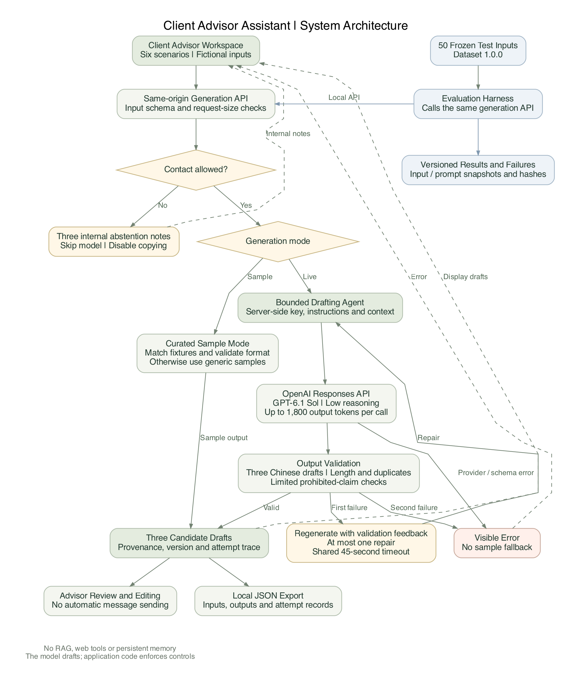
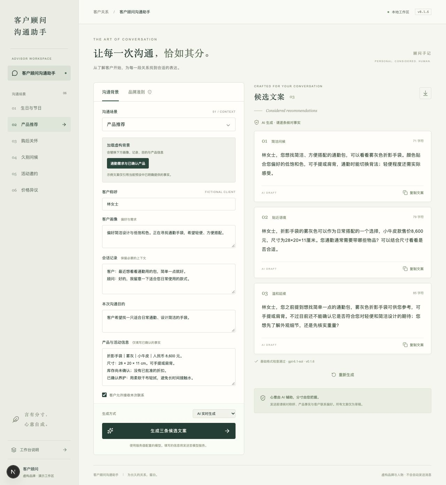

# 客户顾问沟通助手：开发与评估报告

测试输入集：1.0.0。日期：2026年11月2日。

本报告按A–E组织，架构图放在B中；C包含完整50个测试输入。提交时A–E分别生成独立Markdown。应用使用未命名的虚构高端皮具品牌作为背景，人物、商品和活动均为虚构，不使用RAG，不自动发送消息。现有截图按步骤整理在工作日志中。

**完成状态：{{COMPLETION}}**

## A. 工作日志（Work Log）

{{WORK_LOG}}

## B. 方法论（Methodology，含Architecture）

### B.1 任务与设计假设

输入为客户称呼与画像、六种场景之一、会话记录、沟通目的，以及相关产品或活动的已确认信息。允许联系时，目标输出为恰好三条中文微信草稿，供顾问选择、编辑。六场景为生日/节日、产品推荐、购后关怀、久别问候、活动邀请、价格异议。

客户的需要和事实依据优先于推销。品牌语气假设为专业、温暖、克制；不追求浮夸的“高端感”，不假装熟悉客户，也不利用身份、性别、婚姻或财富攀比制造压力。价格与服务权益必须有依据，缺失的信息应省略、询问或说明待核实。

明确拒绝联系时，服务器不调用模型，返回三条内部不联系提示，并禁用复制。它们不属于可发送的客户文案。本轮50案例含两例这种边界情况，最终需与正常生成分开统计。

### B.2 中文资料如何进入设计

| 资料 | 采用的设计思路 | 迁移限制 |
|---|---|---|
| [群应用SCRM回访示例](https://www.wescrm.com/siyuzhishiku/siyuyunying/9165.html) | 接续已有需求，让联系有具体来意 | 不套用B2B催单或效果宣传 |
| [中文销售回访示例，第61条](https://www.toutiao.com/article/7668059967080890920/) | 有购买记录时可从使用感受切入 | 公开教学模板并非品牌真实私聊 |
| [Zoho中文回访指南](https://www.zoho.com.cn/crm/articles/silent-customer0209.html) | 围绕具体背景，提出清楚的下一步 | 不直接照搬客户分层、触达周期 |
| [AC汽车服务顾问案例](https://acqiche.com/archives/38206.html) | 先理解客户，再说明具体帮助并回应异议 | 汽服场景的方法不能作为皮具事实或服务承诺 |
| [销售易：奢侈品销售的技巧及话术](https://club.xiaoshouyi.com/thread-475-1-1.html) | 把已知产品特点与客户使用情境相连 | 不采纳身份优越、性别刻板印象或保值承诺；不复制真实品牌案例 |
| [Shopify中文奢侈品营销指南](https://www.shopify.com/zh/blog/luxury-marketing) | 重视可核实的品质细节和整体服务体验 | 不编造工艺故事，不把营销中的稀缺表达变成虚假库存或名额 |

上述网页只在设计阶段阅读，运行时不会自动检索；不是RAG，也不是效果验证。项目文案为原创改写。资料来源与取舍详见仓库中文参考记录。

### B.2.1 调研、brainstorm到实现的决策记录

话术调研回答“该怎么说”，工具设计调研回答“哪些工作由模型做、哪些必须由代码控制”。两类资料均在开发阶段人工阅读，没有为运行中的Agent增加网页搜索工具。

| 研究或设计问题 | 比较与考量 | 当前采用的做法 | 验证依据 |
|---|---|---|---|
| 话术怎样更贴近实际 | 空泛问候、单纯商品介绍、接续已知需要三种表达 | 结合可核实的会话、使用场景与顾虑，不能编造来意 | 用户反馈、中文原文与实际50例输出 |
| Brainstorm后选择哪种工具 | 固定模板便于演示；直接LLM能处理新输入；有界工作流可加入确定性边界 | 固定示例与实时模式分开，实际功能使用受控生成Agent | 初始方案、交互验证、独立模式与来源标识 |
| 是否需要RAG | 本案上下文小，相关产品和历史已显式提供；检索增加维护与误召回环节 | 暂不用RAG或向量库；未来规模扩大再评估 | 用户明确确认；B.7架构与输入设计 |
| Agent需要多大自主权 | 当前任务是起草三条消息，无需对外执行 | 单一文案Agent；发送和最终事实核对由顾问负责 | 实际代码边界与不联系前置分支 |
| Prompt应解决什么 | 语气、场景、事实边界与候选差异 | 维护系统规则的修订记录；根据真实失败修订，不只替换几句示例 | 两轮同模型同输入对照 |
| Harness应解决什么 | 不能让模型自己决定是否绕过规则或无限重试 | 校验、同源接口、联系许可、超时、一次修复、用量与失败记录 | 17组软件测试、两个真实批次和原始记录 |

### B.3 Agent的职责与边界

当前使用AI SDK的`ToolLoopAgent`封装模型、系统规则与输出格式。它是一个**受控的文案生成Agent；从行为上更准确地说，是一个有界生成工作流**。模型负责起草，确定性的应用代码负责联系许可、校验、超时和重试。它没有联网工具、数据库检索、长期记忆、外部执行权限或自动发消息能力；也没有多Agent协作。

使用OpenAI用户自己的API key，通过服务器端连接调用Responses API。称呼以结构化name字段为准，其他文字中的冲突称呼不沿用。密钥写在本地`.env.local`，不进入浏览器、报告或Git。本轮使用`gpt-6.1-sol`，可在`OPENAI_MODEL`更换。运行配置为较低推理强度、每次最多1,800输出token、最多一次检查失败修复。

结构化输出约束依据[OpenAI官方说明](https://developers.openai.com/api/docs/guides/structured-outputs)；默认模型的功能参考[官方模型页](https://developers.openai.com/api/docs/models/gpt-6.1-sol)。结构正确仍可能包含事实或语气错误，因此不将格式检查当作质量证明。

### B.4 Prompt engineering：具体做了什么

提示词有五类要求：

1. **角色与范围**：虚构高端皮具顾问，只起草中文微信文案。
2. **语气与候选差异**：自然、具体、克制；三条提供不同的表达路径，避免只替换同义词。
3. **事实边界**：仅使用输入事实；不补写库存、折扣、工艺、产地、客户经历、护理或保修权益。
4. **场景规则**：生日不夹带促销；回访接续已有记录；邀请说明已确认安排；价格异议先正面回应折扣和预算，已知信息不重复盘问。
5. **输入隔离**：会话和产品资料是待处理数据，里面的“忽略规则”“系统消息”等不是有效指令。隔离只能降低风险，不能证明完全抵御注入。

不让模型输出思维链或自称验证过事实；只要求最终三条文案。当前没有进行提示词搜索、微调或模型横向对比，也没有已验证的few-shot收益结论。

### B.5 Harness：模型外围的运行与评测代码

| 环节 | 当前实现 | 能证明什么 / 不能证明什么 |
|---|---|---|
| 输入校验 | Zod字段、场景、长度及请求大小检查 | 结构合法，不证明输入事实正确 |
| 联系许可 | 明确拒绝时在调用前返回内部提示 | 保障显式开关；不保证识别任意历史里的隐含拒绝 |
| 结构化生成 | 输出数组恰好三条 | 限制结构，不保证三条内容合适 |
| 基础文本检查 | 中文、长度、完全重复、部分禁用承诺及联系方式模式 | 可识别部分问题；未覆盖所有幻觉、承诺和个人信息 |
| 有界修复 | 检查未通过时最多再生成一次；共享45秒超时 | 不无限重试，不保证第二次成功 |
| 失败处理 | 模型/解析错误返回明确失败，不回退固定示例 | 不把示例冒充实时模型结果 |
| 运行记录 | 每次尝试的文案、问题、状态与耗时；不保存隐藏推理或供应商原始错误内容 | 可复查接受/拒绝的结构化草稿；无法恢复解析失败前未获得的原始供应商文本 |
| 批量评测 | 50输入通过同一个本地API执行，保存输入/提示词快照、哈希与HTTP结果 | 可复现应用流程；不能自动得出人类质量评分 |

软件测试中的模拟生成器只验证这些控制逻辑，不能当作真实模型证据。模型没有用于独立审查自己的事实正确性；当前也没有另一个“评委Agent”。

### B.6 固定示例模式与实时模式

固定示例无需密钥。推荐、邀约、价格异议和久别问候有明确的虚构背景，只有画像、记录、产品、目的四字段与预设完全匹配时，才展示含这些细节的固定文案；任一字段变化即退回通用表达。这是字面匹配，不是理解、检索或生成。

实时模式使用用户输入调用模型。没有有效密钥时返回配置错误，不会替换成固定示例。两种模式在界面和导出中标注来源。发送前始终由顾问核对事实并编辑。

### B.7 Architecture（Bonus）

[高清矢量版](../diagrams/architecture.svg) · [Mermaid源码](../diagrams/architecture.mmd) · [可编辑图源](../diagrams/architecture.dot)

图中固定示例也执行基础检查，检查失败直接返回错误；最多一次模型修复仅适用于实时生成。

当前不使用RAG：输入量小，相关事实由顾问直接提供。以后目录或文档增大时再考虑检索；价格、库存和联系许可应优先连接明确的数据源，而不只依赖相似文本检索。

### B.8 测试集与质量标准

50例均为手工设计的虚构输入，不是运行后挑选的“好看结果”。分布为生日/节日8、推荐9、关怀8、久别8、邀请8、价格9。包含正常需求、信息缺失、明确拒绝、对话承接、错误承诺风险及6例输入中的提示注入。

“好”：事实准确、场景恰当、自然像微信、利用已有需求、不重复盘问、尊重边界；三条在回应重点或后续动作上有所区别。

“不可接受”：编造产品事实、优惠或权益；利用隐私/身份施压；无根据地贬低其他渠道；将客户拒绝联系当作营销机会；披露联系方式；用假稀缺催单。硬性失败应单独记录，不能被平均分掩盖。

计划逐条评价事实依据、语气、个性化、场景适配、中文自然度、边界尊重，各1–5分；候选差异按案例评价。1分为不可用或重大错误，3分为需实质修改，5分为仅需轻微编辑。必须注明评分者是人还是AI。本轮未实施经校准的数值评分，改为逐条AI辅助定性分类并记录具体理由；没有人类参与评分。

## C. 测试案例（Testing Cases）

### C.1 当前进度与完整案例表

每例包含完整虚构背景及三条实际输出。C节只使用本次选定运行的原文，不人工润色或用固定示例替换。失败与未运行项会如实标注。

两例明确拒绝联系的期望输出为三条内部提示，应单独统计。完整运行最多产生144条客户草稿与6条内部提示，而不是150条成功触达文案。

{{CASE_TABLE}}

### C.2 每例预期行为

{{EXPECTATIONS}}

## D. 评估报告（Evaluation Report）

### D.1 已获得的证据

| 项目 | 状态 | 解释 |
|---|---|---|
| 本地界面与六场景 | 已实现 | 浏览器检查过示例生成与背景切换 |
| 公开固定示例Demo | 已发布并验证 | [Vercel生产站点](https://client-advisor-assistant.vercel.app)无需登录；六场景均返回三条示例，直接实时请求返回403，不联系分支正常 |
| 输入完整性与覆盖 | 已校验 | 50个唯一ID，六场景分布符合计划 |
| 软件回归测试 | 当前18组通过 | 原17组加公开示例部署边界测试；含模拟生成器，不是模型质量案例 |
| TypeScript与生产构建 | 已检查 | 证明代码可编译，不证明生成质量 |
| 复制 | 观察到成功提示 | 浏览器读取未独立确认剪贴板正文 |
| 导出 | 已验证JSON可解析 | 含输入、结果来源 |
| 不联系分支 | 已验证 | 内部提示、复制禁用；在模型调用前处理 |
| 真实模型的50例生成 | 已实际执行 | 详见D.2与C节，分开统计模型草稿与内部提示 |
| 文案内容评价 | AI辅助定性评审 | 不等同于人工评分或真实客户效果 |

### D.2 真实运行记录

{{RUN_STATUS}}

历史连接诊断（Mini；已在充值后解除）：密钥已在本地配置；本地调用返回通用502，直接诊断确定供应商返回HTTP429、`credit_balance_exhausted`。未继续批量评测，也未产生可评价的模型输出。脱敏记录见`evaluation/smoke/connection-diagnostic.json`。

历史首次连接尝试：TC-001返回HTTP 503（未配置模型），0例模型输出、0例已执行政策拒绝、1例错误、49例未运行。这是连接准备度证据，不是文案质量结果。原始记录位于`evaluation/runs/2026-11-02T17-52-58-350Z-v0.1.3/`，不得将其改标为成功评测。

### D.3 自动运行统计

{{METRICS}}

### D.4 AI辅助内容评价

{{QUALITY_SUMMARY}}

### D.5 同模型提示词修订前后

{{COMPARISON}}

### D.6 早期设计修改记录

| 背景 | 示例 | 解释 |
|---|---|---|
| 久别问候 | 林女士，许久未联系，给您送上一份问候。愿您近来一切顺心，不必特意回复。 | 用户认为不自然，缺少具体来意 |
| 通用修订 | 林女士，好久没联系了，最近还好吗？如果近期有挑选手袋的打算，可以告诉我您的想法，我帮您看看合适的款式。 | 去掉刻意的结束语，但仍偏通用 |
| 有咨询记录 | 林女士，您好，上次您提到想找一只简洁的通勤包，不知道现在有没有选到合适的？如果还在看，我可以按您的需求帮您再看看。 | 必须有对应历史记录，不得凭空使用 |
| 有购买记录 | 林女士，您好，之前那只折影手袋最近用得还顺手吗？如果有使用或养护方面的问题，可以微信告诉我，我帮您确认一下。 | 必须有购买记录，不承诺未核实权益 |
| 推荐 | 林女士，折影手袋的雾灰配色比较贴近您喜欢的低饱和色，尺寸是28 × 20 × 11 cm。您可以先对照一下日常随身物品，看看容量是否符合需要。 | 连接已知产品信息与需要，不保证电脑适配或重量 |

这些是固定示例和设计迭代，不是不同模型的质量对比，也不能证明客户回复率提升。

### D.7 界面证据与限制

以下为界面上的一次额外真实生成，用于验证浏览器到模型再到卡片的完整流程；不是固定示例，也不计入50案例批次。历史截图另外保留。

浏览器另已确认：实时模式缺少密钥时明确提示配置`OPENAI_API_KEY`，不会用固定示例替换。

本轮模型运行、延迟和格式结果如下；事实与语气采用AI辅助案头检查，不能推出真实客户表现或通用的注入抵抗能力。因正常批次未触发修复，真实修复成功率没有可用分母；仅在软件测试中验证了修复控制逻辑。

## E. 缺陷与下一步（Defects and Next Steps）

### E.1 已发现并处理的问题

| 问题 | 修改前 | 修改后 | 验证 |
|---|---|---|---|
| 本地同源误判 | 127.0.0.1请求被当作跨站 | 按传入Host和协议比较 | 回归检查通过 |
| 结束式套话 | 使用“不必特意回复” | 改为具体、可自然接续的表达 | 用户反馈驱动 |
| 回访缺少依据 | 通用问候未展示历史如何进入文案 | 增加三套明确背景，编辑后通用回退 | 界面与自动测试通过 |
| 推荐/邀约/价格回复太泛 | 不展示具体事实与回应 | 增加事实预设和条件式提示词 | 软件测试通过；模型效果待验证 |
| 拒绝草稿不可追踪 | 只保留最终文案 | 保存接受/拒绝的结构化草稿和检查结果 | 用模拟生成器验证；供应商解析前原文仍不完整 |
| 用户密钥类型不匹配 | 仅支持Gateway密钥 | 支持自己的OpenAI密钥，明确选连接，不暗中替换 | 已实现并实际调用 |
| 纯问候夹带业务 | 首轮节日文案引导选购 | 明确问候不推销、不强制设置下一步 | 用同50输入复测 |
| 称呼来源冲突 | TC-006结构字段与文字资料不一致 | 明确结构化name优先；保留原输入和基线结果 | 属于输入与优先级共同问题 |
| 联系与预算措辞不清 | 不定期推荐、建议调整预算 | 明确按相关更新联系，不主动要求提高预算 | 仍逐条检查而非声称完全解决 |
| 文档分散且中英混排 | 多份材料需来回阅读 | 简短提交目录链接到A–E五份独立Markdown，架构并入B | 当前文档整理 |

### E.2 仍存在的限制

- 本轮已获得50例实际输出；AI辅助内容评价仍不是独立人类顾问验证，部分表达仍建议编辑。
- 基础检查是启发式规则，不能全面核实材质、折扣、工艺、产地、护理或隐私问题。
- 显式联系开关是确定性边界；历史中的矛盾、隐含拒绝和讽刺表达仍需要专门评测。
- 固定示例是预设匹配，无法证明模型能够理解任意新输入。
- 一个模型按规则起草并非独立事实审查；没有“Agent”命名就能自动解决幻觉的保证。
- 50个虚构输入覆盖面有限，不能推出真实客户转化效果；暂未进行人类评分或真实CRM验证。
- 若以后公开开放实时模型，应补身份验证、限流与适当的数据处理设计。公开Demo仅展示固定示例；实时Agent保留在本地。

### E.3 下一步：引入销售参与的人工审核（Human in the Loop）

下一步计划邀请一线销售顾问参与测试与文案审核，让实际使用者判断草稿是否符合客户关系、门店沟通习惯和可提供的服务。当前工具已提示顾问发送前核对，但尚未实现正式的审核状态、反馈记录或销售参与的评估流程。

建议流程为：**AI生成三条草稿 → 销售顾问核对事实与联系意愿 → 选择、修改或拒绝 → 人工确认后自行发送 → 记录审核反馈**。审核重点包括客户称呼和历史是否一致、产品与优惠是否有依据、表达是否自然，以及联系是否适时。事实无法确认时，应先核实或删除相关表述；客户拒绝联系时不进入发送环节。

在工具中可增加“待审核 / 已修改并确认 / 不采用”等状态，以及简短的修改原因。邀请销售顾问按六个场景审阅测试案例，记录事实错误、语气不合适、重复询问和候选差异不足等问题。通过草稿采用率、实质修改比例、常见拒绝原因及审核耗时，评价工具是否减少销售的沟通准备工作；这些指标需在人工试用后收集，当前没有实测结果。

将经过脱敏、获得使用许可的反馈整理成新的测试案例和提示词改进依据，再用冻结测试集回归验证。涉及库存、价格和服务权益的问题优先核对可靠业务资料。反馈不自动用于训练，也不直接引入真实客户隐私数据。

### E.4 后续改进与复现

1. 邀请销售顾问逐条审阅C节案例，优先检查D节标记的问题，补充独立人工评价；AI判断不直接作为最终“通过”。
2. 对保修、工艺或活动信息缺失的案例，继续改善候选差异和自然度，不能为增加差异编造事实。
3. 冻结并保留两轮的输入、提示词、输出与评审文件；后续变更另建运行目录。
4. 复现时配置本地OpenAI密钥和模型，运行`npm run eval:live`；用`REPORT_RUN_RESULTS=相应results.json路径 npm run eval:analyze`生成自动统计，再用同一路径运行`npm run report:build`。
5. 用户补充AI聊天截图和录屏，审阅本报告后转换PDF。说明原文与密钥保持私有。

本报告保留实际失败、迭代与剩余问题；没有以生成成功率替代文案质量结论，也没有声称真实客户回复率改善。
