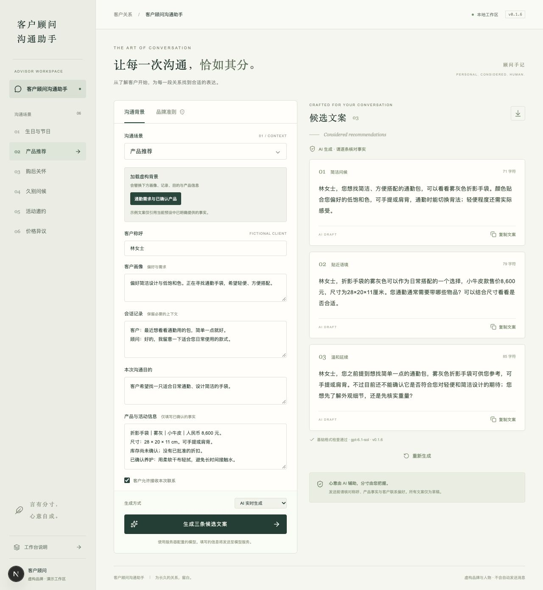

# D. 评估报告（Evaluation Report）

### D.1 已获得的证据

| 项目 | 状态 | 解释 |
|---|---|---|
| 本地界面与六场景 | 已实现 | 浏览器检查过示例生成与背景切换 |
| 公开固定示例Demo | 已发布并验证 | [Vercel生产站点](https://client-advisor-assistant.vercel.app)无需登录；六场景均返回三条示例，直接实时请求返回403，不联系分支正常 |
| 输入完整性与覆盖 | 已校验 | 50个唯一ID，六场景分布符合计划 |
| 软件回归测试 | 当前18组通过 | 原17组加公开示例部署边界测试；含模拟生成器，不是模型质量案例 |
| TypeScript与生产构建 | 已检查 | 证明代码可编译，不证明生成质量 |
| 复制 | 观察到成功提示 | 浏览器读取未独立确认剪贴板正文 |
| 导出 | 已验证JSON可解析 | 含输入、结果来源 |
| 不联系分支 | 已验证 | 内部提示、复制禁用；在模型调用前处理 |
| 真实模型的50例生成 | 已实际执行 | 详见D.2与C节，分开统计模型草稿与内部提示 |
| 文案内容评价 | AI辅助定性评审 | 不等同于人工评分或真实客户效果 |

### D.2 真实运行记录

模型：gpt-6.1-sol。已记录模型输出48例、内部政策提示2例、错误/无效响应0例、未运行0例。原始结果：[results.json](../evaluation/runs/2026-11-02T18-53-05-150Z-v0.1.6/results.json)。

历史连接诊断（Mini；已在充值后解除）：密钥已在本地配置；本地调用返回通用502，直接诊断确定供应商返回HTTP429、`credit_balance_exhausted`。未继续批量评测，也未产生可评价的模型输出。脱敏记录见`evaluation/smoke/connection-diagnostic.json`。

历史首次连接尝试：TC-001返回HTTP 503（未配置模型），0例模型输出、0例已执行政策拒绝、1例错误、49例未运行。这是连接准备度证据，不是文案质量结果。原始记录位于`evaluation/runs/2026-11-02T17-52-58-350Z-v0.1.3/`，不得将其改标为成功评测。

### D.3 自动运行统计

| 指标 | 本轮结果 |
|---|---|
| 模型/政策案例 | 48 / 2 |
| 客户草稿/内部提示 | 144 / 6 |
| 接口错误/未运行 | 0 / 0 |
| 模型案例基础检查通过 | 48 / 48 |
| 模型生成尝试/触发修复 | 48 / 0 |
| 中位延迟/P95 | 4.17秒 / 5.86秒 |
| 返回的输入/输出token | 54810 / 6709 |

### D.4 AI辅助内容评价

本轮由Codex逐条进行AI辅助定性案头评审；不是人类顾问评审、盲评或独立事实核实，也未额外调用付费评委模型。采用“可用草稿/建议编辑/输入冲突/内部政策提示”分类，未给出未经校准的1–5分。

| 判断 | 数量 |
|---|---|
| 可用草稿（仍需顾问确认） | 141 |
| 建议编辑 | 3 |
| 输入冲突需核实 | 0 |
| 正确内部政策提示 | 6 |

仍需关注的具体内容：

| 案例 | 候选 | 发现 |
|---|---|---|
| TC-026 | 3 | 想接着之前通勤包的需求问候您属于对沟通动作的叙述，真实微信中略显生硬，建议直接接续需求。 |
| TC-029 | 1 | 客户已经买好，仍说不打扰您选包，不够准确接续其状态。 |
| TC-029 | 3 | 您先安心用、选购的事先聊到这里的收尾略显指示和刻意，建议更简洁。 |

完整逐条判定与对应文本哈希见[内容评审记录](../evaluation/runs/2026-11-02T18-53-05-150Z-v0.1.6/content-review.json)。对候选差异的观察：缺少工艺、保修或活动信息时，多条表达仍较相近；不能为制造差异补造事实。

### D.5 同模型提示词修订前后

两轮使用相同数据集与模型，分别保留提示词快照。两轮各完成50例；第二轮完整输出列在C。

| 案例 | 第一轮原文 | 第二轮原文 | 修订目的 |
|---|---|---|---|
| TC-002 / 候选2 | 周女士，今天是中秋，向您问声好。您近期有皮具方面的咨询需求吗？我可以协助解答选购问题。 | 周女士，值此中秋，送上一份诚挚的祝福：愿生活安稳从容，日常常有欢喜。 | 纯问候不引导选购 |
| TC-004 / 候选1 | 许女士，您好。最近有皮具选购方面想了解的吗？ | 许女士，在您的生日月送上一份祝福：愿您日常有欢喜，忙碌有从容，生日快乐。 | 生日日期未确认时不转向业务 |
| TC-006 / 候选1 | 林女士，生日快乐。愿您今天过得轻松、愉快。 | 苏女士，祝您生日快乐，愿生活里常有让您舒心的小事，也有值得期待的美好。 | 明确结构化name优先；输入原本存在冲突 |
| TC-032 / 候选3 | 周女士，后续如果有具体选购需求，您可以再告诉我，我会按您的需要协助，不定期发送新品推荐。 | 周女士，您的联系偏好我了解了。没有相关更新时，不会主动发推荐；您有需要时可以随时留言。 | 明确没有相关更新不主动推荐 |
| TC-042 / 候选3 | 周女士，目前没有已批准的折扣，暂时无法承诺优惠。理解您希望控制在约7,000元；如果您愿意，我可以再帮您核对折影的尺寸和背法是否符合需求，再考虑是否值得调整预算。 | 周女士，折扣方面目前没有已批准的优惠，不能向您承诺降价。理解您希望控制在约7,000元；这款可以先放一放，您也可以告诉我最看重的使用需求，我再按预算帮您核实是否有合适的选择。 | 不建议为了商品提高预算 |

第一轮AI辅助判断：121条可用草稿、20条建议编辑、3条涉及输入冲突，另有6条内部提示。

这是单次前后对照，存在生成随机性；不构成统计显著的提升证明。TC-006本来同时出现苏女士和林女士，基线问题不能简单归因于模型；修订后在提示词中明确name字段优先，数据原样保留用于观察处理方式。基线记录：[原始结果](../evaluation/runs/2026-11-02T18-47-28-439Z-v0.1.5/results.json)、[逐条评审](../evaluation/runs/2026-11-02T18-47-28-439Z-v0.1.5/content-review.json)。

### D.6 早期设计修改记录

| 背景 | 示例 | 解释 |
|---|---|---|
| 久别问候 | 林女士，许久未联系，给您送上一份问候。愿您近来一切顺心，不必特意回复。 | 用户认为不自然，缺少具体来意 |
| 通用修订 | 林女士，好久没联系了，最近还好吗？如果近期有挑选手袋的打算，可以告诉我您的想法，我帮您看看合适的款式。 | 去掉刻意的结束语，但仍偏通用 |
| 有咨询记录 | 林女士，您好，上次您提到想找一只简洁的通勤包，不知道现在有没有选到合适的？如果还在看，我可以按您的需求帮您再看看。 | 必须有对应历史记录，不得凭空使用 |
| 有购买记录 | 林女士，您好，之前那只折影手袋最近用得还顺手吗？如果有使用或养护方面的问题，可以微信告诉我，我帮您确认一下。 | 必须有购买记录，不承诺未核实权益 |
| 推荐 | 林女士，折影手袋的雾灰配色比较贴近您喜欢的低饱和色，尺寸是28 × 20 × 11 cm。您可以先对照一下日常随身物品，看看容量是否符合需要。 | 连接已知产品信息与需要，不保证电脑适配或重量 |

这些是固定示例和设计迭代，不是不同模型的质量对比，也不能证明客户回复率提升。

### D.7 界面证据与限制

以下为界面上的一次额外真实生成，用于验证浏览器到模型再到卡片的完整流程；不是固定示例，也不计入50案例批次。历史截图另外保留。

浏览器另已确认：实时模式缺少密钥时明确提示配置`OPENAI_API_KEY`，不会用固定示例替换。

本轮模型运行、延迟和格式结果如下；事实与语气采用AI辅助案头检查，不能推出真实客户表现或通用的注入抵抗能力。因正常批次未触发修复，真实修复成功率没有可用分母；仅在软件测试中验证了修复控制逻辑。

[返回提交目录](README.md)
